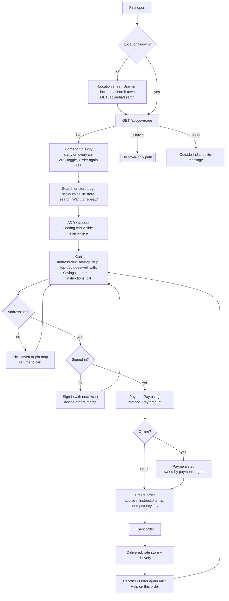
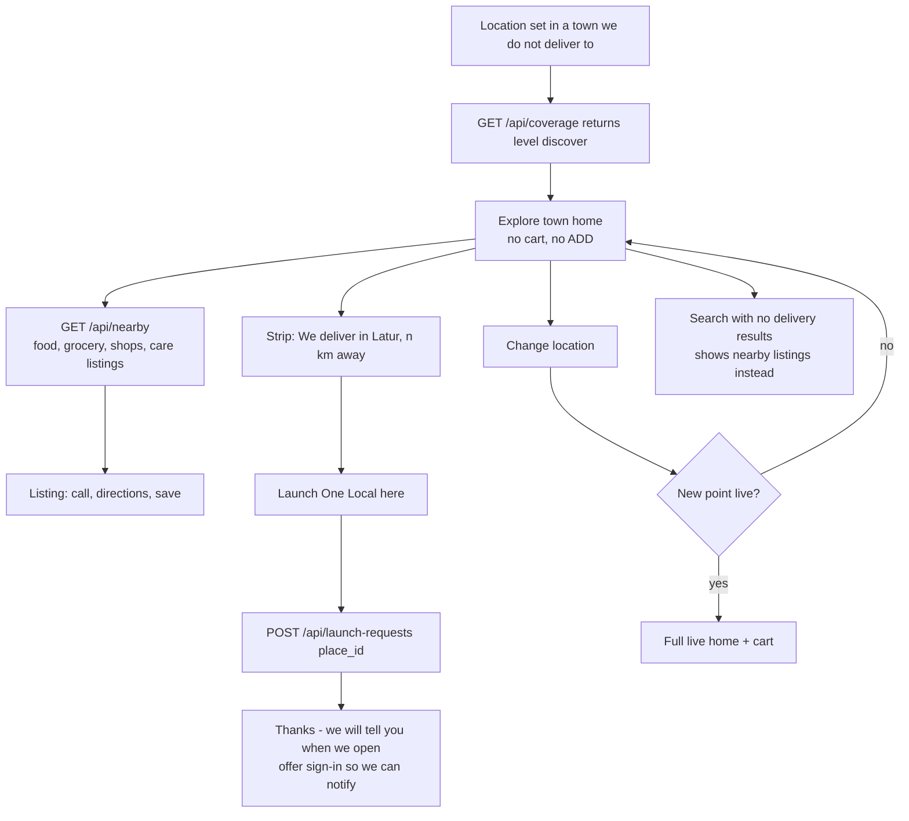

# One Local vs Swiggy: user flows and friction

Study area: the whole customer journey, from first open to reorder, plus search, filters, repeat orders and the moment a guest signs in.
Sources: the Swiggy notes from 27 Sep 2026 (observed signed in, so Swiggy's fresh-install flow was **not** seen), and the code in `frontend/`. All paths below are relative to `frontend/`.

---

## 1. The big picture in five findings

1. **The cart never asks where the order is going.** `POST /api/orders` sends items, totals, coupon and payment method only (`app/(tabs)/cart.tsx:94-104`, `server/store.ts:125`). It sends no address, map point, phone number or delivery instructions. The cart shows a fixed line, "Sample order · estimated 10 min · Latur" (`cart.tsx:139-145`). Swiggy puts the address in the cart header and lets you change it there.
2. **The All-India work is not visible in the app.** The server now has `/api/coverage` (live / discover / soon), `/api/nearby`, `/api/india/search` and `/api/launch-requests`, but no screen calls any of them (searched all of `src/` and `app/`, excluding `app/api`). The app never sends a city (`src/api.ts` has no `x-city`), so the server always uses Latur (`server/catalog.ts:95`). Picking a pin outside Latur is a dead end: "doesn't deliver here yet", and the confirm button is disabled (`app/address-map.tsx:93-96`).
3. **First open asks for sign-in before asking for location.** The welcome gate opens `/sign-in?welcome=1` on first launch (`src/components/app-shell.tsx:26-38`). The location stays at the placeholder "Latur, Maharashtra" (`app-shell.tsx:56`) and GPS is never offered unless the user taps the small address line. Swiggy's home is built around the address.
4. **Moving from browsing to paying has gaps.** The store page has no floating cart (`app-shell.tsx:94` shows the floating cart on some routes but not `/store/*`). The store page has no search inside the store and its category chips don't stay pinned (`app/store/[id].tsx:167-191`). Reorder quietly adds items and leaves you on the orders page (`app/orders.tsx:32-39`).
5. **Nothing happens after an order.** The tracking page ends with "Continue shopping" (`app/order/[id].tsx:231`). There is no rating, no reorder button and no "get help with this order". Help is a list of FAQs plus a free-text form (`app/help.tsx:7-16`), while Swiggy's help starts from the order.

What already works and should be kept:
- The server quotes every bill, so the cart and checkout can never disagree (`cart.tsx:35-50`, `server/pricing.ts:71`).
- A smart top-up rail suggests the items that close the free-delivery gap (`cart.tsx:147-167`, `pricing.ts:18-26`).
- GST is shown honestly (`cart.tsx:262-277`).
- Checkout can't create duplicate orders (`cart.tsx:93`).
- A guest's orders follow them after sign-in: `listOrders` matches both the device and the signed-in user (`server/store.ts:143-146`).
- Browsing never needs an account.

---

## 2. Flow table

| # | Step | Swiggy (observed) | One Local today | Gap | Fix |
|---|---|---|---|---|---|
| 1 | First open | Not observed (signed in). The home header is always the saved address label plus the full address on one line. | Intro, then a sign-in screen pushed once with "Skip for now" (`app-shell.tsx:26-38`, `app/sign-in.tsx:65`) | Asks for commitment before showing any value. Location is never asked. | Ask for **location first** (GPS or search). Sign-in only at pay (see #11). |
| 2 | Set location | Address label in the header opens the address list | Small 10pt address line (`app-shell.tsx:77`) → `/location` → search (Google autocomplete, `app/location.tsx:33`) or "Use current location" → pin map → address form → back to home (`app/address-form.tsx:55`) | 4–5 screens to set a first address, and the target is small. The India-wide place list (`/api/india/search`, free) is not used. | On first open, show a sheet with "Use my location" and a town search on `/api/india/search`. Ask for the full door-level address only at checkout. |
| 3 | Coverage check | n/a (Swiggy is everywhere) | Binary serviceable yes/no from a map pin. When it's no, confirm is disabled (`address-map.tsx:93-96`) | **Dead end** for every town outside Latur | Call `/api/coverage`. **live** leads to the full app. **discover** leads to "Explore <town>" (nearby listings plus "Launch here"). **soon** gets a polite message. |
| 4 | Home browse | Service tabs, search with rotating placeholder, VEG toggle, chip row, offers, restaurant list, floating cart bar, Reorder tab | Rich home rails (`app/(tabs)/index.tsx:25-58`), collapsing header with search, voice and camera (`app-shell.tsx:78-92`), floating cart (`app-shell.tsx:94`) | No veg toggle. There is a diet preference (`src/customer.tsx:18`) but nothing reads it. No "Reorder" or "Buy again" at the top level. Home is the same in every town. | Add a VEG toggle next to search, seeded from `profile.diet`. Add a "Order again" rail at the top of home from past orders. Build home from coverage. |
| 5 | Store page | Info card (ETA, locality, rating), rotating offer strip, dish search, veg/non-veg toggles, **"Want to repeat?"**, sticky filter chips, floating **ITEMS** section menu, cart bar | Media carousel, logo, meta chips, follow button, category chips, 2-column grid (`store/[id].tsx:99-211`) | No cart bar here (the only way out is back). Chips scroll away. No in-store search, veg filter, repeat card or offer strip. | Show the floating cart on `/store/*`. Pin the chips with `stickyHeaderIndices`. Add in-store search. Add a "Want to repeat?" card built from this store's past order lines. |
| 6 | Add item | ADD on the photo turns into a − n + stepper | Same pattern (`src/components/product-card.tsx:24`), plus a fly-to-cart animation | Parity | none |
| 7 | Cart header | Store name, plus "➤ Home \| address ▾" to change the address inline | "Your little bag · n items" and Cart / One Saver tabs (`cart.tsx:123-124`) | No address. You can't change where it's delivered without leaving the cart. | Add an address row under the title that opens the saved-addresses sheet. When there is no address, "Add address" opens the pin map and returns to `/cart` (not `/(tabs)`). |
| 8 | Savings strip | Green "₹86 saved!" line at the top | "You save ₹X" at the bottom of the bill (`cart.tsx:278-282`). The floating cart hard-codes ₹199 for free delivery (`src/components/floating-cart.tsx:31`) | Savings are hidden at the bottom, and the hard-coded ₹199 will go wrong once pricing changes (`server/pricing.ts:30`) | Move `bill.total_savings` into a strip at the top of the cart. The floating cart should read `free_delivery_from` from the quote. |
| 9 | Upsell ("Complete your meal") | Tabs: Popular / Beverages / Desserts / Sides, with a + on each tile | Smart top-up shown only when you're short of free delivery (`cart.tsx:147-167`) | Once delivery is free, nothing is suggested | Keep the top-up. After free delivery, show a "Goes well with" rail from the same store's categories (server: `quote()` already knows the departments). |
| 10 | Coupons / Savings corner | "SAVINGS CORNER": Apply Coupon ›, auto-applied offers with ✓ Applied | Type a code, and suggestions only fill in the text box (`cart.tsx:198-246`). A separate One Saver tab (`cart.tsx:127`) | Two places, typing required, no auto-apply | Show one "Savings corner" card listing coupons from `GET /api/coupons` with a one-tap Apply and ✓ Applied states. Auto-apply the best eligible one. Merge the One Saver tab into it. |
| 11 | Sign-in handover | Already signed in | Never asked at checkout. The order is tied to the device (`server/store.ts:43-47`). Sign-in merges the device's orders (`store.ts:143-146`) | Good for guests, but you can't send a real order without a phone number. `next=` exists (`sign-in.tsx:29-33`) but is never used from the cart. | When Pay is tapped with no session (or no phone), open sign-in with `?next=/cart`. The cart stays because it's saved on the device (`src/cart.tsx:32`). Later: phone OTP. |
| 12 | Delivery type / tip / instructions | Segmented control: Delivery Type (Express +₹29, Standard, Eco Saver), Tip, Instructions. Also "Cooking requests" and "Cutlery needed?" | Address instructions exist in the address form (`address-form.tsx:99`) but never reach the order. No tip, no delivery type, no cutlery or cooking notes. | The rider and the store get no notes | Add a "Delivery instructions" chip row plus a free text box, prefilled from the address. Add a tip (₹10/20/30, off by default) as a bill line in `pricing.ts`. Delivery type later, once there are riders. |
| 13 | Bill | "To Pay ~~₹224~~ ₹138", collapsible | Full bill with GST breakdown (`cart.tsx:250-284`) | Parity or better. The struck-through "before" total is missing from the top line. | Show the struck-through `item_mrp_total + fee` on the To Pay line and in the pay bar. |
| 14 | Pay | Sticky bar: "PAY USING ▲ card ··XXXX" on the left, green "Pay ₹138" on the right. Full-screen Payment Options with a route card (store → home, ETA) | Payment row in the middle of the cart (`src/components/checkout-payment.tsx:12`) and a bar with "Place sample order" (`cart.tsx:289-298`) | The payment method isn't next to the pay button | Put "Pay using ▲" into the sticky bar, left side. Payment internals belong to the Razorpay agent. This study only fixes **where** they go: tapping Pay leads to the payment step, then the order. |
| 15 | Track | Not captured | Countdown, sample route, timeline, rider card (`app/order/[id].tsx:119-229`) | Good as a sample. Nothing to act on afterwards. | After "Delivered": show rating stars, a Reorder button and "Need help with this order?" |
| 16 | Rate | Past orders show separate Food Rating and Delivery Rating stars | none | No feedback loop for stores | Add two star rows on the order card and order detail, via `POST /api/orders/:id/rating` (new) |
| 17 | Reorder | Big peach Reorder button on each past order, in the Profile past-orders list and a Reorder tab | Profile → My Orders → Reorder adds on top of the current cart and stays put (`orders.tsx:32-39`) | No choice between replacing and merging. No move to the cart. No price or stock re-check. The page has no cart bar. | Ask once: "Replace cart" or "Add to cart". Then go to `/cart`. The quote re-checks prices and stock, and any item no longer sold shows as a notice. |
| 18 | "Want to repeat?" | First card on the restaurant page | `/api/products/buy-again` is a fixed sample list (`app/api/products/buy-again+api.ts:5`) | Not personal | Build buy-again from `ol_order_items` for this customer, filterable by store |
| 19 | Search | Rotating placeholder, mic, VEG box. Finds dishes and restaurants. | Header search (`app-shell.tsx:78`) → `/search`: filters the catalogue on the phone by product only, with department chips (`app/search.tsx:22-29`) | No recent searches, no store results, no veg filter or sort. The server search route (`app/api/search/[...path]`) is unused here. | Add recent searches plus "Popular near you". Add a Stores section in results. Add veg and price-sort chips. Rotate the placeholder. |
| 20 | Help | Help starts from an order: recent order card, then issues. Also refunds. | FAQs plus a topic and free-text form (`help.tsx:7-16`) | The customer has to describe which order they mean | Put the recent order card at the top of Help; tapping it opens help pre-filled with `reference=order id` (the field already exists, `help.tsx:15`) |

---

## 3. Tap counts for key tasks

Taps only, not typing. Swiggy counts assume signed in with a saved address and card, as observed. One Local counts are from the current code.

| Task | Swiggy | One Local today | Notes |
|---|---|---|---|
| First open until you can see products | not observed | **1** (Skip on sign-in) | We're fine on taps but show a placeholder Latur location |
| Set a first delivery address with GPS | not observed | **5** (address line → Use current location → OS allow → Confirm pin → Save), plus typing | Target after the fix: **2** on first open (Use my location → Allow). Door-level details come at checkout. |
| Search an item → add → pay | **5** (search → suggestion → ADD → View cart → Pay) | **4** (search → ADD → floating cart → Place order) | Ours is shorter only because we skip the address and payment. After the fix it should be about 5, which matches Swiggy. |
| From a store page, add → reach the cart | **2** (ADD → cart bar) | **3** (ADD → back → floating cart) | Fix: show the floating cart on the store page |
| Change delivery address at the cart | **2** (address ▾ → pick saved) | **4+** (back → address line → saved address → floating cart). You can't do it from the cart itself. | Fix: address row in the cart |
| Apply a coupon | **2** (Apply Coupon → Apply) | **2** (tap suggestion → Apply) | Target: **1** with auto-apply, or tap-to-apply in the Savings corner |
| Reorder a past order | **3** (Profile → Reorder → Pay) or 2 with the Reorder tab | **7** (Profile → My Orders → Reorder → back → back → header bag → Place order) | Target: **3** (home "Order again" → Reorder → Pay) |
| Veg-only browsing | **1** (VEG toggle) | not possible | Target: **1** |
| Find a dish inside a store | **1–2** (dish search, or ITEMS menu → section) | chips only, and they scroll away | Target: **1** (sticky in-store search) |
| Get help on the last order | **1** (Recent order card) | **3** (Profile → Help → form) plus typing the order id | Target: **1** |
| Tell us to open in my town | n/a | not possible (dead end) | Target: **1** ("Launch One Local here" → `POST /api/launch-requests`) |

---

## 4. Top 10 changes, ranked by impact for the effort

Effort: S = under a day, M = 1–3 days, L = a week or more.

1. **Location first, coverage-aware start (M, highest impact).**
   - Replace `useWelcomeGate` (`app-shell.tsx:28-38`) with a first-open location sheet: "Use my location" plus a town search on `GET /api/india/search?q=`.
   - Then call `GET /api/coverage?lat&lng` and store `{ level, city, place }` in `DeliveryLocationContext` (`src/delivery-location.ts`).
   - `src/api.ts` sends `x-city` from it on every call.
   - Make the header address line bigger: a bold label plus one line of address, like Swiggy.
   - Sign-in moves to checkout (#4).
2. **Discover-only town path (M).**
   - When coverage is `discover`, the home shows an "Explore <town>" page built from `GET /api/nearby?lat&lng`: listings by food, grocery, shops and care, with call, directions and save. No cart and no ADD buttons.
   - Show a strip: "We deliver in Latur, <n> km away. Want One Local here?" with a button that sends `POST /api/launch-requests { place_id }` and then shows "Thanks, we'll tell you".
   - `address-map.tsx:93-96` should show that same message and a way into Explore mode, instead of a disabled button.
   - Rename the current "Discover" tab (`src/components/bottom-navigation.tsx:12`), or use a different word for this level (for example "Explore"), so the two meanings don't clash.
3. **Address and delivery notes in the cart and in the order (M).**
   - Cart header row "➤ Home | line, locality ▾" opens a bottom sheet of saved addresses (reuse the rows from `app/location.tsx:96-121`) plus "Add new".
   - `address-form.tsx:55` returns to the screen it came from (`next` param) rather than `/(tabs)`.
   - The order body gains `address { label, line, locality, pin, lat, lng, instructions }` and `contact_phone`. `buildOrder` (`server/store.ts:125`) checks it and refuses if coverage isn't `live`.
   - Pay is disabled until an address is set, with the label "Add address to continue".
4. **Sign in just in time, at Pay (S).**
   - When Pay is tapped with no session, push `/sign-in?next=/cart`. `leave()` already honours `next` (`sign-in.tsx:29-33`). The cart survives because it's saved on the device (`src/cart.tsx:32`).
   - Remove the first-launch push.
   - Later (L): phone-number OTP as the main sign-in, because the phone is what the rider needs.
5. **Pay bar and where payment sits (S).**
   - Sticky bottom bar: on the left "PAY USING ▲ <method>", which opens the existing `CheckoutPayment` sheet; on the right "Pay ₹X" with the struck-through before-savings total.
   - Move `CheckoutPayment` (`cart.tsx:248`) out of the scrolling area.
   - Order of events: address check → sign-in check → payment step (Razorpay, owned by the payments agent; cash on delivery skips it) → create order → tracking.
6. **Store page: find and act without leaving (M).**
   - Show `FloatingCart` on `/store/*` (`app-shell.tsx:94`).
   - Pin the chip row (`stickyHeaderIndices` in `store/[id].tsx:110`).
   - Add a "Search in <store>" field that filters `products` on the phone.
   - Add a veg toggle (needs a `veg` flag on the product).
   - Add a "Want to repeat?" card from this customer's past lines at this store (see #7).
7. **Reorder that finishes the job (S/M).**
   - `orders.tsx:32-39`: if the cart isn't empty, ask "Replace cart / Add to it"; then go to `/cart`. The quote re-checks prices and stock, and missing items show as a notice.
   - Add a Reorder button on `order/[id].tsx` and an "Order again" rail at the top of home.
   - Make `GET /api/products/buy-again` real, using `ol_order_items` for the caller, with `?store=` for the store page. Today it's a fixed set (`buy-again+api.ts:5`).
8. **One Savings corner and extras (S).**
   - Merge the coupon box and the One Saver tab (`cart.tsx:124-127, 198-246`) into a "Savings corner" card: a list from `GET /api/coupons` with tap-to-apply, ✓ Applied, and auto-apply of the best eligible one.
   - Add a green "₹X saved" strip at the top of the cart from `bill.total_savings`.
   - `floating-cart.tsx:31` should use the quote's `free_delivery_from`, not 199.
   - Add a tip chip row (₹0/10/20/30) as a `tip` line in `server/pricing.ts`.
   - Add "No cutlery / cooking note" for food orders.
9. **After delivery: rate, reorder, get help (M).**
   - Once the order is "Delivered", `order/[id].tsx` shows two star rows (store and delivery), via a new `POST /api/orders/:id/rating`.
   - Past-order cards in `orders.tsx` show the same stars.
   - Help (`help.tsx`) opens with the most recent order card; tapping it prefills `reference` with the order id and shows issue chips (missing item, wrong item, late, payment), not an empty text box.
10. **Search that helps you choose (M).**
    - `/search` gains:
      - recent searches (saved on the device)
      - "Popular near you" before typing
      - a Stores section in the results
      - chips for veg, "under ₹99" and sort by price
      - a rotating placeholder in the header
    - Use the server search (`app/api/search/[...path]`) so results follow the city.
    - A search with no results in a discover-only town shows nearby listings instead.

---

## 5. Proposed happy path (live city)

## 6. Discover-only town path

---

## 7. Open questions for the founder

- In a discover-only town, should listings show a phone number to call? (That needs a policy on publishing data from OpenStreetMap.)
- Tip: is it allowed and what are the defaults? Does 100% of it go to the rider?
- Should one cart hold items from more than one store? Products carry `store_id` (`src/api.ts:70`), but the cart and the order ignore it. Swiggy food keeps one restaurant per cart.
- Sign-in method at checkout: stay with email and password for now, or go straight to phone OTP?
